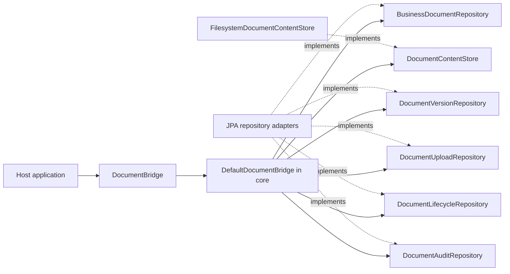

# DokuBridge

Embeddable document versioning for Java applications. See [PROJECT.md](PROJECT.md)
for scope and [AGENTS.md](AGENTS.md) for engineering rules.

## Build

Requires JDK 21 and network access to Maven Central on the first build.

```sh
./mvnw verify
```

The `core` module contains the domain snapshots, immutable JSON metadata and the
facade `DocumentBridge`, implemented by `DefaultDocumentBridge`. Its outbound
ports are `BusinessDocumentRepository`, `DocumentVersionRepository`,
`DocumentContentStore`, `DocumentUploadRepository` and `DocumentLifecycleRepository`.
The `filesystem` module provides immutable local content storage. Neither module
adds third-party runtime dependencies. The `jpa` module supplies PostgreSQL-backed
persistence adapters, Flyway migrations and short upload reservation/finalization
transactions. `autoconfigure` wires these components in Spring Boot 3, `starter`
provides host dependencies, and `sample-app` is an executable console example.

`DocumentVersion` transitions only from `PENDING` to `AVAILABLE` or `FAILED`.
Finalization returns a new snapshot; it does not persist state or store bytes.
Repeated finalization of a terminal snapshot is rejected. This local invariant
does not implement request idempotency or concurrency control in persistence.

The filesystem adapter requires a private application-controlled directory on a
filesystem with hard-link support. It publishes complete content under version
UUIDs, rejects duplicate keys and refuses to read symbolic links. See
[PROJECT.md](PROJECT.md#content-storage-contract) for failure and recovery limits.

All modules build with the command above. The PostgreSQL tests require a running
Docker daemon; Testcontainers starts and stops PostgreSQL 17.6 automatically. Tests fail
when Docker is unavailable rather than silently skipping persistence checks.
`verify` also packages the sample and runs its mandatory Failsafe integration test,
which launches the JAR twice in separate JVMs. The dependency-only starter has no
unit tests; sample verification runs after packaging rather than in `test`.
To run just the filesystem adapter and its core prerequisite:

```sh
./mvnw -pl filesystem -am verify
```

## Library artifacts

`package` and `verify` attach `-sources.jar` and `-javadoc.jar` alongside the
compiled JAR for `core`, `filesystem`, `jpa` and `autoconfigure`. Outputs are in
each module's `target` directory; for example:

```text
core/target/dokubridge-core-0.1.0-SNAPSHOT.jar
core/target/dokubridge-core-0.1.0-SNAPSHOT-sources.jar
core/target/dokubridge-core-0.1.0-SNAPSHOT-javadoc.jar
```

Run `./mvnw install` to install all modules, their parent POM and attached
artifacts into the local Maven repository. Other projects can then depend on
`dokubridge-starter`; IDEs can resolve library source and API documentation through
the standard Maven classifiers. The host manages its Spring Boot version through
its own parent or BOM.

Javadoc validates references and markup during the normal build. Missing comments
are allowed; broken documentation fails the build. Documentation generation does
not fetch external API links. The dependency-only starter and executable sample
produce their existing JARs without source or Javadoc attachments.

## Ports and adapters

The common namespace is `io.github.pitrecki.dokubridge`. Source packages follow
these roles, enforced by ArchUnit tests in each module:

```text
core/
  core.domain.document/          document, owner, metadata and lifecycle
  core.domain.version/           version snapshots and states
  core.domain.content/           SHA-256 value
  core.domain.audit/             audit entries and actions
  core.domain.<feature>.exception/ document, version, content and upload errors
  core.port.in/                  DocumentBridge
    document/                    metadata, archive and delete commands
    upload/                      attach, add-version and reconciliation commands
  core.port.out/
    document/                    document reads and lifecycle persistence
    version/                     version lookup and history
    upload/                      reservation and finalization contracts
    audit/                       audit history contract
    content/                     binary storage contract
  core.application/              DefaultDocumentBridge
    upload/                      DocumentUploads and request fingerprinting
filesystem/
  adapter.filesystem.content/     FilesystemDocumentContentStore
jpa/
  adapter.jpa.document/           document repositories
    persistence/                 document entity, projection and JSONB mapping
  adapter.jpa.version/            version repository
    persistence/                 version entity
  adapter.jpa.upload/             upload repository
    persistence/                 request entity
  adapter.jpa.audit/              audit repository
    persistence/                 audit entity
autoconfigure/
  autoconfigure/                  Spring Boot composition
starter/                         dependency-only JAR
sample-app/
  sample/                        console client of DocumentBridge
```

The public Java packages now follow features within each architectural layer.
Update imports and rebuild consumers; this changes their binary class names.
`core.port.in.DocumentBridge` and `core.application.DefaultDocumentBridge` retain
their paths. Domain exceptions live with the feature that owns them.

| Previous import suffix | Current import suffix |
| --- | --- |
| `core.domain.BusinessDocument` | `core.domain.document.BusinessDocument` |
| `core.domain.ContentSha256` | `core.domain.content.ContentSha256` |
| `core.domain.DocumentVersion` | `core.domain.version.DocumentVersion` |
| `core.port.in.AttachDocument` | `core.port.in.upload.AttachDocument` |
| `core.port.in.UpdateMetadata` | `core.port.in.document.UpdateMetadata` |
| `core.port.out.DocumentVersionRepository` | `core.port.out.version.DocumentVersionRepository` |
| `adapter.jpa.JpaDocumentUploadRepository` | `adapter.jpa.upload.JpaDocumentUploadRepository` |
| `adapter.jpa.persistence.*` | `adapter.jpa.<feature>.persistence.*` |
| `adapter.filesystem.FilesystemDocumentContentStore` | `adapter.filesystem.content.FilesystemDocumentContentStore` |

Custom entity manager factories must update explicit library scans to the four
feature persistence packages, or scan `io.github.pitrecki.dokubridge.adapter.jpa`.
Boot auto-configuration registers the four packages automatically. JPA entity
names, SQL tables, Flyway migrations and persisted request fingerprints are
unchanged by the package split.



The facade exposes `attach`, `addVersion`, `updateMetadata`, `archive`, `delete`,
`get`, `findByOwner`, `getVersions`, `getAudit`, `getContent` and `reconcileUpload`.
Active and archived documents are readable; deleted documents appear absent. Content is available
only for an `AVAILABLE` version belonging to the requested document, regardless
of whether bytes already exist in storage. The host application authorizes callers
and closes content streams. See [PROJECT.md](PROJECT.md#read-facade) for errors,
metadata types and consistency limits.

The JPA module also implements `DocumentUploadRepository` for atomic request
claims, version allocation and audit finalization, plus `DocumentAuditRepository`
for committed audit history. No generic transaction runner or JPA-specific facade
is used. Its migration location is `classpath:db/dokubridge` with a dedicated
`dokubridge_flyway_history` table; migration is an explicit host setup step.

To run PostgreSQL integration checks with the other modules:

```sh
./mvnw -pl jpa -am verify
```

Uploads require a UUID request key and a declared `ContentSha256`. The core facade
verifies new streams, while PostgreSQL atomically claims requests, assigns version
numbers and records audits. Matching replays return the current version without
reading or writing bytes again. JSON object key order and numeric scale do not
create false conflicts. Both active and archived documents accept new versions.
The original three-port facade constructor remains read-only. The existing
upload constructor accepts `DocumentUploadRepository` as its fourth argument;
its five-port variant also enables lifecycle mutations. Audit composition is
shown below. The starter wires all six ports.

Metadata replacement and logical lifecycle changes are atomic with their audits.
Automatic recovery and physical retention/purge remain unimplemented. See
[PROJECT.md](PROJECT.md#request-idempotency) for replay and checksum contracts and
[PostgreSQL persistence](PROJECT.md#postgresql-persistence) for transaction setup.


## Version history

```java
import io.github.pitrecki.dokubridge.core.domain.version.DocumentVersion;
import io.github.pitrecki.dokubridge.core.port.in.DocumentBridge;
import java.util.List;

List<DocumentVersion> history = bridge.getVersions(documentId);
```

History includes `PENDING`, `AVAILABLE` and `FAILED` versions, ordered by version
number. The returned list is immutable. Active and archived documents expose their
history; missing or deleted documents raise `DocumentNotFoundException`. Listing
performs no content I/O and does not make pending or failed content downloadable.
The host authorizes access. This MVP operation returns the full list without
pagination; it has the same snapshot and transaction-isolation limits as other reads.

The existing `DocumentVersionRepository` now has a default `findByDocument` method.
Custom repositories must implement it to support history; its default throws
`UnsupportedOperationException`. Existing single-version implementations and
custom facades remain usable after updating imports. JPA and the starter support
history without new configuration or a database migration.

## Audit history

```java
import io.github.pitrecki.dokubridge.core.domain.audit.DocumentAuditEntry;
import java.util.List;

List<DocumentAuditEntry> audit = bridge.getAudit(documentId);
```

The facade returns an immutable list of document and upload events in database
insertion order. Timestamps may move backwards across producers and do not define
this order. Active and archived documents are visible; missing or deleted
documents raise `DocumentNotFoundException` before querying audit. No content is
opened and reading history adds no event. The host authorizes access. The operation
returns the full list without pagination, with the same snapshot/isolation limits
as other reads.

Upload actions carry version/request UUIDs; metadata, archive and delete actions
have null values for both. Check `entry.action().requiresUploadContext()` before
using those identifiers. Audit records contain no copied document metadata or
binary content. The lower-level `DocumentAuditRepository` retains all events,
including deletion history; its visibility is controlled by the host.

For manual composition, inject the existing audit port:

```java
var readOnly = new DefaultDocumentBridge(documents, versions, audits, content);
var full = new DefaultDocumentBridge(documents, versions, content, uploads, lifecycle, audits);
```

Repository arguments precede content in the audit-enabled read-only constructor,
so the existing four-argument upload constructor remains usable. The original
three-, four- and five-port compositions still work; they do not enable audit
history. Custom facades inherit an unsupported default `getAudit` method. Boot
passes the selected `DocumentAuditRepository` bean to the facade and respects a
host-provided replacement. No new property, dependency or migration is required.

## Interrupted uploads

```java
var result = bridge.reconcileUpload(new ReconcileUpload(requestId, versionId));
```

For `PENDING`, reconciliation verifies the existing immutable blob against the
checksum recorded at reservation: matching content becomes `AVAILABLE`, mismatched
content becomes `FAILED`, and missing content stays `PENDING`. Storage errors
propagate without finalization. Terminal versions return unchanged. Recovery and
its audit commit together; concurrent matching finalizations add one audit.
Reconciliation performs no content writes or deletion and does not expose deleted
documents. The host authorizes calls and must invoke them outside its transactions.

Apply migration V3 before using the current JPA adapter. Older requests lack the
original checksum: legacy pending requests raise `UploadChecksumUnavailableException`
without changing state, while legacy terminal results remain readable. A replay
never backfills the checksum from caller input. There is no recovery scheduler or
cleanup process. See [PROJECT.md](PROJECT.md#explicit-upload-reconciliation) for
adapter guarantees and legacy limitations.

## Metadata and lifecycle

```java
var document = bridge.get(documentId).orElseThrow();
var updated = bridge.updateMetadata(new UpdateMetadata(
    document.id(), document.revision(), Map.of("category", "revised")));
bridge.archive(new Archive(document.id()));
bridge.delete(new Delete(document.id()));
```

Metadata is replaced completely, including on archived documents. The returned
snapshot carries the next revision. A stale `expectedRevision` conflicts; an empty
map clears metadata. Content-version allocation does not advance document revision.

Repeated archive/delete produces no additional change or audit. Deleted documents
are hidden, while binary files, versions and history remain retained. A reserved
upload can finish after deletion without making content visible. Document-only
audit events have null version/request ids; upload audits retain both identifiers.
See [PROJECT.md](PROJECT.md#document-lifecycle) for concurrency and retry semantics.
Migration V2 upgrades existing V1 data without modifying the original migration.

## Spring Boot host setup

Build and install the project locally with `./mvnw install`, then add the starter:

```xml
<dependency>
  <groupId>io.github.pitrecki.dokubridge</groupId>
  <artifactId>dokubridge-starter</artifactId>
  <version>0.1.0-SNAPSHOT</version>
</dependency>
```

Configure a PostgreSQL data source through normal Spring Boot properties and set
`dokubridge.storage.root` to a private application-controlled directory. Inject
`core.port.in.DocumentBridge` to use the library. The default repositories require
the selected entity manager factory's `JpaTransactionManager`; upload calls must
run outside host transactions.

| Property | Default | Behavior |
| --- | --- | --- |
| `dokubridge.enabled` | `true` | Enables library entity registration and default beans. |
| `dokubridge.storage.root` | unset | Required unless a `DocumentContentStore` bean is supplied. |
| `dokubridge.jpa.initialize-schema` | `false` | Runs the library Flyway migrations before JPA initialization. |

Host beans replace the corresponding default ports or facade. The entity scan
adds library entities while retaining the host's implicit scan or explicit
`@EntityScan`. Custom entity manager factories must include the library persistence
package themselves. Use a single or primary data source, entity manager factory
and transaction manager.

If the host already manages library migrations, leave schema initialization off.
Otherwise enable `dokubridge.jpa.initialize-schema=true`. The initializer waits for
Boot's host Flyway migrations, then uses its own `dokubridge_flyway_history` table.
For an existing host schema it creates a library-only baseline at version 0 before
running V1. It does not expose a competing Flyway bean or replace host history.

## Run the sample

The sample requires these environment variables for a development PostgreSQL
instance and content directory:

- `SPRING_DATASOURCE_URL`
- `SPRING_DATASOURCE_USERNAME`
- `SPRING_DATASOURCE_PASSWORD`
- `DOKUBRIDGE_STORAGE_ROOT`

After `./mvnw verify`:

```sh
java -jar sample-app/target/dokubridge-sample-app-0.1.0-SNAPSHOT.jar
```

The console application enables library schema initialization, validates the JPA
schema, attaches a document, replays the request, adds version 2 and verifies its
download, ordered version history and audit through `DocumentBridge`. It then
replaces metadata, archives and logically deletes that example document, verifies read invisibility, prints its id
and exits. Each run creates another retained, logically deleted example document. It enables no HTTP endpoints and disables the
sample's separate host Flyway instance; these settings belong to the sample only.
The packaged integration test supplies an isolated PostgreSQL container and checks
two complete runs, retained data, migration history and stored files.
