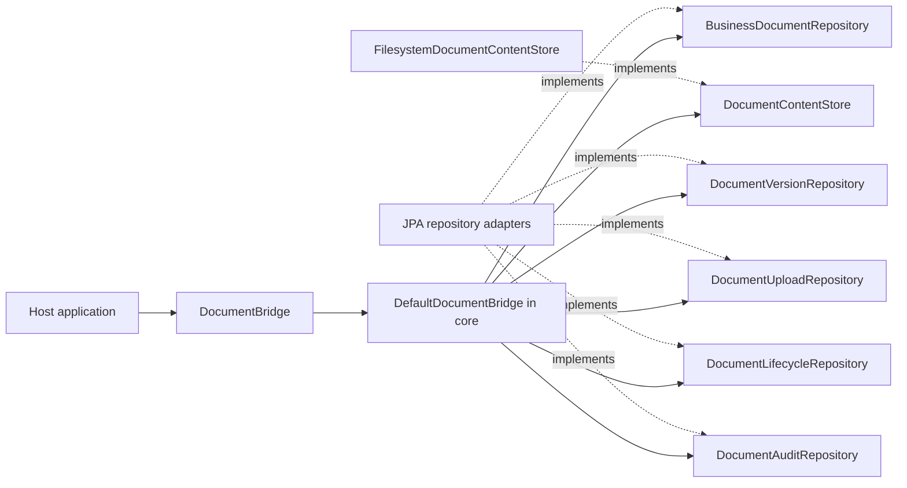

# DokuBridge

Embeddable document versioning for Java applications. See [PROJECT.md](PROJECT.md)
for scope and [AGENTS.md](AGENTS.md) for engineering rules.

```java
bridge.upload(bytes)
    .toOwner("Invoice", "42")
    .metadata("category", "invoice")
    .save().and().archive();
```

Or continue in a callback:

```java
bridge.upload(bytes)
    .toOwner("Invoice", "42")
    .metadata("category", "invoice")
    .saveAndThen(document -> document.archive());
```

Each example uploads one file once, then archives its document. A second upload
is needed only when adding another content version.
The fluent API supplies SHA-256 for byte arrays and a fresh request key for each
save. Use an explicit request key when an upload must support idempotent retries.

## Build

Requires JDK 21 and network access to Maven Central on the first build.

```sh
./mvnw verify
```

The `core` module contains the domain snapshots, immutable JSON metadata and the
facade `DocumentBridge`, implemented by `DefaultDocumentBridge`. Its outbound
ports are `BusinessDocumentRepository`, `DocumentVersionRepository`,
`DocumentContentStore`, `DocumentUploadRepository` and `DocumentLifecycleRepository`.
The core uses Guava `Closer` for managed stream cleanup and exception suppression.
The `filesystem` module provides immutable local content storage and adds no
further runtime libraries beyond core. The `jpa` module supplies PostgreSQL-backed
persistence adapters, Flyway migrations and short upload reservation/finalization
transactions. `autoconfigure` wires these components in Spring Boot 3, `starter`
provides host dependencies, and `sample-app` is an executable console example.

`DocumentVersion` transitions only from `PENDING` to `AVAILABLE` or `FAILED`.
Finalization returns a new snapshot; it does not persist state or store bytes.
Repeated finalization of a terminal snapshot is rejected. This local invariant
does not implement request idempotency or concurrency control in persistence.

The filesystem adapter requires a private application-controlled directory on a
filesystem with hard-link support. It publishes complete content under version
UUIDs, rejects duplicate keys and refuses to read symbolic links. See
[PROJECT.md](PROJECT.md#content-storage-contract) for failure and recovery limits.

All modules build with the command above. The PostgreSQL tests require a running
Docker daemon; Testcontainers starts and stops PostgreSQL 17.6 automatically. Tests fail
when Docker is unavailable rather than silently skipping persistence checks.
`verify` also packages the sample and runs its mandatory Failsafe integration test,
which launches the JAR twice in separate JVMs. The dependency-only starter has no
unit tests; sample verification runs after packaging rather than in `test`.
To run just the filesystem adapter and its core prerequisite:

```sh
./mvnw -pl filesystem -am verify
```

CI also checks a standalone host in `integration-tests/starter-consumer` after
installing the library. That project has its own Spring Boot BOM and no library
parent or reactor membership, so it resolves the installed starter and its
transitive dependencies. The test starts PostgreSQL through Testcontainers and
exercises fluent upload/replay, downloads, owner lookup, metadata and lifecycle
operations. Run the same checks locally from the repository root:

```sh
./mvnw install
./scripts/verify-consumer.sh
```

Use the same local Maven repository for both commands. This consumer check runs
separately from the normal reactor `verify`; it needs the artifacts installed by
the first command. The helper reads the root project's effective Maven version
and supplies it to the independent consumer as `dokubridge.version`. The consumer
has no default library version, so it cannot silently test a previously cached
release when the root version changes. The helper accepts Maven options such as
`-s settings.xml` and `-Dmaven.repo.local=/path/to/repository`; it forwards them to
both Maven invocations. Version evaluation uses the pinned Maven Help plugin.

## Library artifacts

`package` and `verify` attach `-sources.jar` and `-javadoc.jar` alongside the
compiled JAR for `core`, `filesystem`, `jpa` and `autoconfigure`. Outputs are in
each module's `target` directory; for example:

```text
core/target/dokubridge-core-0.1.0-SNAPSHOT.jar
core/target/dokubridge-core-0.1.0-SNAPSHOT-sources.jar
core/target/dokubridge-core-0.1.0-SNAPSHOT-javadoc.jar
```

Run `./mvnw install` to install all modules, their parent POM and attached
artifacts into the local Maven repository. Other projects can then depend on
`dokubridge-starter`; IDEs can resolve library source and API documentation through
the standard Maven classifiers. The host manages its Spring Boot version through
its own parent or BOM.

Javadoc validates references and markup during the normal build. Missing comments
are allowed; broken documentation fails the build. Documentation generation does
not fetch external API links. The dependency-only starter and executable sample
produce their existing JARs without source or Javadoc attachments.

## Ports and adapters

The common namespace is `io.github.pitrecki.dokubridge`. Source packages follow
these roles, enforced by ArchUnit tests in each module:

```text
core/
  core.domain.document/          document, owner, metadata and lifecycle
  core.domain.version/           version snapshots and states
  core.domain.content/           SHA-256 value
  core.domain.audit/             audit entries and actions
  core.domain.<feature>.exception/ document, version, content and upload errors
  core.port.in/                  DocumentBridge
    document/                    lifecycle commands, fluent contexts and results
    upload/                      upload commands and fluent drafts
  core.port.out/
    document/                    document reads and lifecycle persistence
    version/                     version lookup and history
    upload/                      reservation and finalization contracts
    audit/                       audit history contract
    content/                     binary storage contract
  core.application/              DefaultDocumentBridge
    upload/                      DocumentUploads and request fingerprinting
filesystem/
  adapter.filesystem.content/     FilesystemDocumentContentStore
jpa/
  adapter.jpa.document/           document repositories
    persistence/                 document entity, projection and JSONB mapping
  adapter.jpa.version/            version repository
    persistence/                 version entity
  adapter.jpa.upload/             upload repository
    persistence/                 request entity
  adapter.jpa.audit/              audit repository
    persistence/                 audit entity
autoconfigure/
  autoconfigure/                  Spring Boot composition
starter/                         dependency-only JAR
sample-app/
  sample/                        console client of DocumentBridge
```

The public Java packages now follow features within each architectural layer.
Update imports and rebuild consumers; this changes their binary class names.
`core.port.in.DocumentBridge` and `core.application.DefaultDocumentBridge` retain
their paths. Domain exceptions live with the feature that owns them.

| Previous import suffix | Current import suffix |
| --- | --- |
| `core.domain.BusinessDocument` | `core.domain.document.BusinessDocument` |
| `core.domain.ContentSha256` | `core.domain.content.ContentSha256` |
| `core.domain.DocumentVersion` | `core.domain.version.DocumentVersion` |
| `core.port.in.AttachDocument` | `core.port.in.upload.AttachDocument` |
| `core.port.in.UpdateMetadata` | `core.port.in.document.UpdateMetadata` |
| `core.port.out.DocumentVersionRepository` | `core.port.out.version.DocumentVersionRepository` |
| `adapter.jpa.JpaDocumentUploadRepository` | `adapter.jpa.upload.JpaDocumentUploadRepository` |
| `adapter.jpa.persistence.*` | `adapter.jpa.<feature>.persistence.*` |
| `adapter.filesystem.FilesystemDocumentContentStore` | `adapter.filesystem.content.FilesystemDocumentContentStore` |

Custom entity manager factories must update explicit library scans to the four
feature persistence packages, or scan `io.github.pitrecki.dokubridge.adapter.jpa`.
Boot auto-configuration registers the four packages automatically. JPA entity
names, SQL tables, Flyway migrations and persisted request fingerprints are
unchanged by the package split.



The facade exposes `attach`, `addVersion`, `updateMetadata`, `archive`, `delete`,
`get`, `findByOwner`, `getVersions`, `getAudit`, `getContent` and `reconcileUpload`.
Active and archived documents are readable; deleted documents appear absent. Content is available
only for an `AVAILABLE` version belonging to the requested document, regardless
of whether bytes already exist in storage. The host application authorizes callers
and closes raw content streams. See [PROJECT.md](PROJECT.md#read-facade) for errors,
metadata types and consistency limits.

The JPA module also implements `DocumentUploadRepository` for atomic request
claims, version allocation and audit finalization, plus `DocumentAuditRepository`
for committed audit history. No generic transaction runner or JPA-specific facade
is used. Its migration location is `classpath:db/dokubridge` with a dedicated
`dokubridge_flyway_history` table; migration is an explicit host setup step.

To run PostgreSQL integration checks with the other modules:

```sh
./mvnw -pl jpa -am verify
```

Uploads require a UUID request key and a declared `ContentSha256`. The core facade
verifies new streams, while PostgreSQL atomically claims requests, assigns version
numbers and records audits. Matching replays return the current version without
reading or writing bytes again. JSON object key order and numeric scale do not
create false conflicts. Both active and archived documents accept new versions.
The original three-port facade constructor remains read-only. The existing
upload constructor accepts `DocumentUploadRepository` as its fourth argument;
its five-port variant also enables lifecycle mutations. Audit composition is
shown below. The starter wires all six ports.

Metadata replacement and logical lifecycle changes are atomic with their audits.
Automatic recovery and physical retention/purge remain unimplemented. See
[PROJECT.md](PROJECT.md#request-idempotency) for replay and checksum contracts and
[PostgreSQL persistence](PROJECT.md#postgresql-persistence) for transaction setup.


## Fluent operations

Uploads start with content, followed by a required owner. Only a completed draft
exposes `save()`. Metadata replacement similarly requires `atRevision(...)` before
`save()` becomes available. Creating/configuring drafts performs no repository
or stream I/O; upload and metadata writes happen at `save()`.

For an upload that can be retried, select the request key before the first save:

```java
var upload = bridge.upload(bytes)
    .toOwner("Invoice", "42")
    .metadata("category", "invoice")
    .requestId(requestId);

var first = upload.save();
var replay = upload.save();
assert first.result().equals(replay.result());
```

`save()` returns `DocumentResult<T>`: `result()` exposes the immutable operation
snapshot and `and()` continues on the same document without another lookup or
upload. For example, after saving one file:

```java
var saved = upload.save();
var version = saved.result();
var document = saved.and();
var history = document.versions();
var audit = document.audit();
try (var input = document.content()) {
    // Read the version selected by this upload; close the stream here.
}
```

`document.upload(revisedBytes).save()` adds the next content version. Its result
selects that new version for `content()`; an earlier result still selects its
original version. Metadata and archive continuations preserve that selection.
No context caches document state or bypasses download visibility checks.

`saveAndThen(action)` is equivalent to `save().andThen(action)` and returns the
original operation result after the callback. Callbacks accept document operations
and checked `IOException`, including reads through `content()`. They run once per
normally returning save, including keyed replays returning `PENDING` or `FAILED`.
An upload exception skips the callback. A callback exception propagates unchanged;
previously committed operations remain committed. The chain is sequential and uses
the existing transaction boundary of each operation. Retrying a keyed upload runs
its callback again, so upload idempotency does not make arbitrary callbacks
idempotent.

The fluent return types have changed: use `save().result()` to obtain the former
`DocumentVersion` or `BusinessDocument` snapshot, and `archive().result()` for an
archive snapshot. Command-based facade return types are unchanged.

Every unkeyed `save()` creates a new request, including repeated saves of one
draft. A keyed save follows the existing replay/conflict rules. Draft configuration
is immutable: byte arrays and JSON metadata are copied when supplied, so branching
a draft or modifying the original input does not change another draft.
`metadata(map)` replaces the attachment draft's complete map;
`metadata(key, value)` adds/replaces one entry, including JSON null. Maps such as
`Map<String, String>` are accepted without casts.

Streams require the original declared checksum and stay caller-owned:

```java
try (var input = Files.newInputStream(path)) {
    var version = bridge.upload(input, expectedSha256)
        .toOwner("Invoice", "42")
        .requestId(requestId)
        .save().result();
}
```

Stream drafts neither buffer, rewind nor close input, including on failure and
replay. Supply a fresh stream for a new upload. Large content can use this path
without the byte-array snapshot. Checksums accept `ContentSha256` or its hex string;
`ContentSha256.of(bytes)` is available for callers that need the value explicitly.

For a document id obtained elsewhere, `bridge.findDocument(id)` reads a snapshot
with a continuation, as shown below. `bridge.document(id)` binds the id without
loading or caching its state. Its
terminal reads are `get()`, `versions()`, `audit()` and `content(versionId)`;
callers close returned content streams. `upload(...)` starts a version draft,
while `archive()` and `delete()` execute those operations directly. Metadata uses
`replaceMetadata(map).atRevision(revision).save()` as shown below. Owner lookup
also accepts `bridge.findByOwner("Invoice", "42")`; explicit recovery accepts
`bridge.reconcileUpload(requestId, versionId)`.

Fluent operations call the existing command/query facade. Visibility, authorization
by the host, version numbering, revision conflicts, audit and transaction behavior
remain the same. Existing command-based calls and custom facade implementations
remain supported; no additional Spring bean or storage adapter is needed.

### Reading content with automatic close

`readContent(reader)` opens the version selected by an upload result, invokes the
reader once and closes the stream before returning its value. For a document
obtained by id or owner, pass the version explicitly:

```java
import java.io.InputStream;
import java.nio.charset.StandardCharsets;

byte[] bytes = saved.and().readContent(InputStream::readAllBytes);

var found = bridge.findDocument(documentId).orElseThrow();
String text = found.and().readContent(versionId,
    input -> new String(input.readAllBytes(), StandardCharsets.UTF_8));
```

`DocumentContentReader<T>` accepts a checked `IOException` and can process content
incrementally; the helper adds no buffering or transaction. The borrowed stream
is valid during the reader call and is closed afterward, including on reader or
stream errors. Return parsed data rather than retaining or returning the stream.
Reader exceptions propagate; a simultaneous close failure is suppressed on the
original exception. If only close fails, that error propagates instead of returning
the reader's value. A null reader is rejected before I/O.

These reads enforce the same visibility, document/version association and
`AVAILABLE` checks as `content()`. An open failure skips the reader. Reading adds
no state change or audit. A context with no selected version requires the explicit
version overload. `content()` and `content(versionId)` continue to return raw
streams that the caller closes.

### Document by id

`findDocument(id)` returns `Optional<DocumentResult<BusinessDocument>>`. Read the
snapshot through `result()` and continue through `and()` without another lookup:

```java
bridge.findDocument(documentId).ifPresent(found -> {
    found.and().replaceMetadata(Map.of("category", "reviewed"))
        .atRevision(found.result().revision())
        .save();
});
```

Active and archived documents are visible; a missing or deleted document returns
an empty Optional. Query errors propagate. The snapshot stays unchanged by later
operations; continuations check current state, so stale metadata revisions can
conflict and deletion can make a subsequent operation fail. The query selects no
content version; use `content(versionId)` for downloads. The host authorizes access.
Lookup and subsequent operations retain their own transaction boundaries.
Existing `get(id)` still returns a domain snapshot, while `document(id)` binds a
context without a lookup. Custom facades inherit `findDocument` through their
existing `get` implementation.

### Documents by owner

`documentsForOwner(type, id)` returns immutable results with the same visible
documents and order as `findByOwner`. It also accepts a `DocumentOwnerRef`.
`result()` exposes the query snapshot without another lookup; `and()` continues
on that document. A lookup can return several documents for one owner.

To update the first result when one exists:

```java
bridge.documentsForOwner("Invoice", "42").stream().findFirst()
    .ifPresent(found -> {
        var snapshot = found.result();
        found.and().replaceMetadata(Map.of("category", "reviewed"))
            .atRevision(snapshot.revision())
            .save();
    });
```

`result()` supplies metadata and the observed revision from the original query.
`and()` binds subsequent operations to that document without extracting its UUID.
The first result does not imply the newest document; select by your application's
criteria when an owner has several documents.

To update every result:

```java
for (var found : bridge.documentsForOwner("Invoice", "42")) {
    found.and().replaceMetadata(Map.of("category", "reviewed"))
        .atRevision(found.result().revision())
        .save();
}
```

Active and archived documents are visible; deleted documents are hidden. An owner
without documents has an empty list. Results retain their original snapshots;
continuations use current state, so a later deletion hides the document and a
changed revision can conflict. The lookup selects no content version: use
`content(versionId)` or a subsequent upload's continuation for downloads.
The host authorizes access. There is no pagination or transaction spanning the
lookup and subsequent operations. Existing custom facades inherit this method
through their `findByOwner` implementation.

## Version history

```java
import io.github.pitrecki.dokubridge.core.domain.version.DocumentVersion;
import io.github.pitrecki.dokubridge.core.port.in.DocumentBridge;
import java.util.List;

List<DocumentVersion> history = bridge.document(documentId).versions();
```

History includes `PENDING`, `AVAILABLE` and `FAILED` versions, ordered by version
number. The returned list is immutable. Active and archived documents expose their
history; missing or deleted documents raise `DocumentNotFoundException`. Listing
performs no content I/O and does not make pending or failed content downloadable.
The host authorizes access. This MVP operation returns the full list without
pagination; it has the same snapshot and transaction-isolation limits as other reads.

The existing `DocumentVersionRepository` now has a default `findByDocument` method.
Custom repositories must implement it to support history; its default throws
`UnsupportedOperationException`. Existing single-version implementations and
custom facades remain usable after updating imports. JPA and the starter support
history without new configuration or a database migration.

## Audit history

```java
import io.github.pitrecki.dokubridge.core.domain.audit.DocumentAuditEntry;
import java.util.List;

List<DocumentAuditEntry> audit = bridge.document(documentId).audit();
```

The facade returns an immutable list of document and upload events in database
insertion order. Timestamps may move backwards across producers and do not define
this order. Active and archived documents are visible; missing or deleted
documents raise `DocumentNotFoundException` before querying audit. No content is
opened and reading history adds no event. The host authorizes access. The operation
returns the full list without pagination, with the same snapshot/isolation limits
as other reads.

Upload actions carry version/request UUIDs; metadata, archive and delete actions
have null values for both. Check `entry.action().requiresUploadContext()` before
using those identifiers. Audit records contain no copied document metadata or
binary content. The lower-level `DocumentAuditRepository` retains all events,
including deletion history; its visibility is controlled by the host.

For manual composition, inject the existing audit port:

```java
var readOnly = new DefaultDocumentBridge(documents, versions, audits, content);
var full = new DefaultDocumentBridge(documents, versions, content, uploads, lifecycle, audits);
```

Repository arguments precede content in the audit-enabled read-only constructor,
so the existing four-argument upload constructor remains usable. The original
three-, four- and five-port compositions still work; they do not enable audit
history. Custom facades inherit an unsupported default `getAudit` method. Boot
passes the selected `DocumentAuditRepository` bean to the facade and respects a
host-provided replacement. No new property, dependency or migration is required.

## Interrupted uploads

```java
var result = bridge.reconcileUpload(requestId, versionId);
```

For `PENDING`, reconciliation verifies the existing immutable blob against the
checksum recorded at reservation: matching content becomes `AVAILABLE`, mismatched
content becomes `FAILED`, and missing content stays `PENDING`. Storage errors
propagate without finalization. Terminal versions return unchanged. Recovery and
its audit commit together; concurrent matching finalizations add one audit.
Reconciliation performs no content writes or deletion and does not expose deleted
documents. The host authorizes calls and must invoke them outside its transactions.

Apply migration V3 before using the current JPA adapter. Older requests lack the
original checksum: legacy pending requests raise `UploadChecksumUnavailableException`
without changing state, while legacy terminal results remain readable. A replay
never backfills the checksum from caller input. There is no recovery scheduler or
cleanup process. See [PROJECT.md](PROJECT.md#explicit-upload-reconciliation) for
adapter guarantees and legacy limitations.

## Pending upload discovery

Discover uploads to inspect without knowing their request/version ids beforehand:

```java
var page = bridge.pendingUploads(100);
if (!page.isEmpty()) {
    var nextPage = bridge.pendingUploads(100, page.getLast().requestId());
}
```

Each `PendingUpload` exposes `requestId()`, `documentId()` and `versionId()`. Pass a
chosen entry's request/version ids to `reconcileUpload` when you want to verify it.
Listing itself reads no files, changes no state and writes no audit. It can include
uploads still in progress. Legacy pending uploads without a recorded checksum are
included; their reconciliation retains the `UploadChecksumUnavailableException`
behavior described above.

Pages are immutable, with a size from 1 to 1000, ordered lexicographically by the
canonical request UUID. The cursor is exclusive; null starts the first page.
Only `PENDING` uploads of active or archived documents are returned; deleted
documents and terminal versions are excluded before applying the limit. An empty
page ends the current scan. Pages are independent snapshots: concurrent inserts
behind the cursor require a new scan from the start, and an entry may finish
before you reconcile it.

The host authorizes this global query and invokes it outside host transactions,
like reconciliation. The existing upload repository composition enables discovery;
read-only compositions without that port remain unsupported. Custom repositories
and facades inherit unsupported defaults until they implement discovery. JPA uses
the existing tables and indexes, with no migration or new dependency.

## Metadata and lifecycle

```java
var found = bridge.findDocument(documentId).orElseThrow();
var updated = found.and().replaceMetadata(Map.of("category", "revised"))
    .atRevision(found.result().revision())
    .save();
updated.and().archive().and().delete();
```

Metadata is replaced completely, including on archived documents. `updated.result()`
carries the next revision. A stale `expectedRevision` conflicts; an empty
map clears metadata. Content-version allocation does not advance document revision.

Repeated archive/delete produces no additional change or audit. Deleted documents
are hidden, while binary files, versions and history remain retained. A reserved
upload can finish after deletion without making content visible. Document-only
audit events have null version/request ids; upload audits retain both identifiers.
See [PROJECT.md](PROJECT.md#document-lifecycle) for concurrency and retry semantics.
Migration V2 upgrades existing V1 data without modifying the original migration.

## Spring Boot host setup

Build and install the project locally with `./mvnw install`, then add the starter:

```xml
<dependency>
  <groupId>io.github.pitrecki.dokubridge</groupId>
  <artifactId>dokubridge-starter</artifactId>
  <version>0.1.0-SNAPSHOT</version>
</dependency>
```

Configure a PostgreSQL data source through normal Spring Boot properties and set
`dokubridge.storage.root` to a private application-controlled directory. Inject
`core.port.in.DocumentBridge` to use the library. The default repositories require
the selected entity manager factory's `JpaTransactionManager`; upload calls must
run outside host transactions.

| Property | Default | Behavior |
| --- | --- | --- |
| `dokubridge.enabled` | `true` | Enables library entity registration and default beans. |
| `dokubridge.storage.root` | unset | Required unless a `DocumentContentStore` bean is supplied. |
| `dokubridge.jpa.initialize-schema` | `false` | Runs the library Flyway migrations before JPA initialization. |

Host beans replace the corresponding default ports or facade. The entity scan
adds library entities while retaining the host's implicit scan or explicit
`@EntityScan`. Custom entity manager factories must include the library persistence
package themselves. Use a single or primary data source, entity manager factory
and transaction manager.

If the host already manages library migrations, leave schema initialization off.
Otherwise enable `dokubridge.jpa.initialize-schema=true`. The initializer waits for
Boot's host Flyway migrations, then uses its own `dokubridge_flyway_history` table.
For an existing host schema it creates a library-only baseline at version 0 before
running V1. It does not expose a competing Flyway bean or replace host history.

## Run the sample

The sample requires these environment variables for a development PostgreSQL
instance and content directory:

- `SPRING_DATASOURCE_URL`
- `SPRING_DATASOURCE_USERNAME`
- `SPRING_DATASOURCE_PASSWORD`
- `DOKUBRIDGE_STORAGE_ROOT`

After `./mvnw verify`:

```sh
java -jar sample-app/target/dokubridge-sample-app-0.1.0-SNAPSHOT.jar
```

The console application uses fluent continuations, callbacks and document/owner lookups, enables library schema initialization,
validates the JPA schema, attaches a document, replays the request, adds version 2 and verifies its
download, ordered version history and audit through `DocumentBridge`. It then
replaces metadata, archives and logically deletes that example document, verifies read invisibility, prints its id
and exits. Each run creates another retained, logically deleted example document. It enables no HTTP endpoints and disables the
sample's separate host Flyway instance; these settings belong to the sample only.
The packaged integration test supplies an isolated PostgreSQL container and checks
two complete runs, retained data, migration history and stored files.
