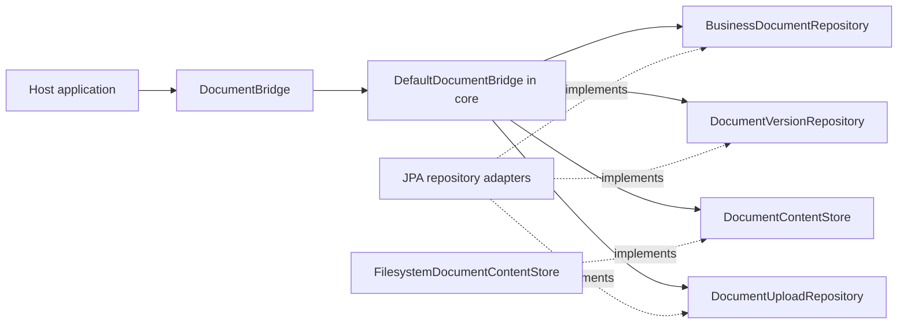

# DokuBridge

Embeddable document versioning for Java applications. See [PROJECT.md](PROJECT.md)
for scope and [AGENTS.md](AGENTS.md) for engineering rules.

## Build

Requires JDK 21 and network access to Maven Central on the first build.

```sh
./mvnw verify
```

The `core` module contains the domain snapshots, immutable JSON metadata and the
facade `DocumentBridge`, implemented by `DefaultDocumentBridge`. Its outbound
ports are `BusinessDocumentRepository`, `DocumentVersionRepository`,
`DocumentContentStore` and `DocumentUploadRepository`.
The `filesystem` module provides immutable local content storage. Neither module
adds third-party runtime dependencies. The `jpa` module supplies PostgreSQL-backed
persistence adapters, Flyway migrations and short upload reservation/finalization
transactions.

`DocumentVersion` transitions only from `PENDING` to `AVAILABLE` or `FAILED`.
Finalization returns a new snapshot; it does not persist state or store bytes.
Repeated finalization of a terminal snapshot is rejected. This local invariant
does not implement request idempotency or concurrency control in persistence.

The filesystem adapter requires a private application-controlled directory on a
filesystem with hard-link support. It publishes complete content under version
UUIDs, rejects duplicate keys and refuses to read symbolic links. See
[PROJECT.md](PROJECT.md#content-storage-contract) for failure and recovery limits.

All modules build with the command above. The JPA tests require a running Docker
daemon; Testcontainers starts and stops PostgreSQL 17.6 automatically. Tests fail
when Docker is unavailable rather than silently skipping persistence checks.
To run just the filesystem adapter and its core prerequisite:

```sh
./mvnw -pl filesystem -am verify
```

## Ports and adapters

The common namespace is `io.github.pitrecki.dokubridge`. Source packages follow
these roles, enforced by ArchUnit tests in each module:

```text
core/
  core.domain/               document model, metadata and checksums
    exception/               domain errors
  core.port.in/              DocumentBridge, AttachDocument, AddDocumentVersion
  core.port.out/             repository and content-store contracts
  core.application/          DefaultDocumentBridge and request fingerprinting
filesystem/
  adapter.filesystem/        FilesystemDocumentContentStore
jpa/
  adapter.jpa/               Jpa*Repository implementations
    persistence/             JPA entities and JSONB mapping
```

The flat `core` and `filesystem` public packages have been replaced by these
namespaces; consumers must update their Java imports. JPA entity names and SQL
table names remain independent of the Java package layout.



The facade exposes `attach`, `addVersion`, `get`, `findByOwner` and `getContent`.
Active and archived documents are readable; deleted documents appear absent. Content is available
only for an `AVAILABLE` version belonging to the requested document, regardless
of whether bytes already exist in storage. The host application authorizes callers
and closes content streams. See [PROJECT.md](PROJECT.md#read-facade) for errors,
metadata types and consistency limits.

The JPA module also implements `DocumentUploadRepository` for atomic request
claims, version allocation and audit finalization, plus `DocumentAuditRepository`
for committed audit history. No generic transaction runner or JPA-specific facade
is used. Its migration location is `classpath:db/dokubridge` with a dedicated
`dokubridge_flyway_history` table; migration is an explicit host setup step.

To run PostgreSQL integration checks with the other modules:

```sh
./mvnw -pl jpa -am verify
```

Uploads require a UUID request key and a declared `ContentSha256`. The core facade
verifies new streams, while PostgreSQL atomically claims requests, assigns version
numbers and records audits. Matching replays return the current version without
reading or writing bytes again. JSON object key order and numeric scale do not
create false conflicts. Both active and archived documents accept new versions.
The original three-port facade constructor remains read-only; pass a fourth
`DocumentUploadRepository` argument to enable uploads.

Metadata updates, archive/delete commands, recovery/cleanup, Spring Boot wiring and
the sample application remain unimplemented. See
[PROJECT.md](PROJECT.md#request-idempotency) for replay and checksum contracts and
[PostgreSQL persistence](PROJECT.md#postgresql-persistence) for transaction setup.
