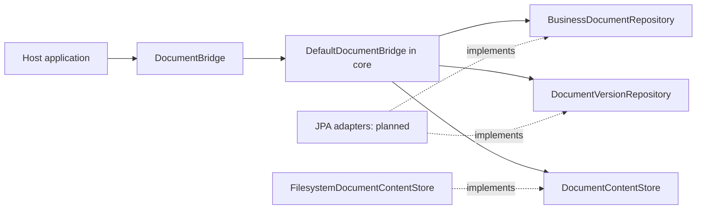

# DokuBridge

Embeddable document versioning for Java applications. See [PROJECT.md](PROJECT.md)
for scope and [AGENTS.md](AGENTS.md) for engineering rules.

## Build

Requires JDK 21 and network access to Maven Central on the first build.

```sh
./mvnw verify
```

The `core` module contains the domain snapshots, immutable JSON metadata and the
read facade `DocumentBridge`, implemented by `DefaultDocumentBridge`. Its outbound
ports are `BusinessDocumentRepository`, `DocumentVersionRepository` and
`DocumentContentStore`.
The `filesystem` module provides immutable local content storage. Neither module
adds third-party runtime dependencies.

`DocumentVersion` transitions only from `PENDING` to `AVAILABLE` or `FAILED`.
Finalization returns a new snapshot; it does not persist state or store bytes.
Repeated finalization of a terminal snapshot is rejected. This local invariant
does not implement request idempotency or concurrency control in persistence.

The filesystem adapter requires a private application-controlled directory on a
filesystem with hard-link support. It publishes complete content under version
UUIDs, rejects duplicate keys and refuses to read symbolic links. See
[PROJECT.md](PROJECT.md#content-storage-contract) for failure and recovery limits.

Both modules build with the command above. To run just the adapter and its core
prerequisite:

```sh
./mvnw -pl filesystem -am verify
```

## Ports and adapters



The facade exposes `get`, `findByOwner` and `getContent`. Active and archived
documents are readable; deleted documents appear absent. Content is available
only for an `AVAILABLE` version belonging to the requested document, regardless
of whether bytes already exist in storage. The host application authorizes callers
and closes content streams. See [PROJECT.md](PROJECT.md#read-facade) for errors,
metadata types and consistency limits.

Write operations, request idempotency, JPA adapters, Spring Boot integration and
the sample application are not implemented yet. Repository implementations used
by the current tests are test fixtures, not production persistence adapters.
