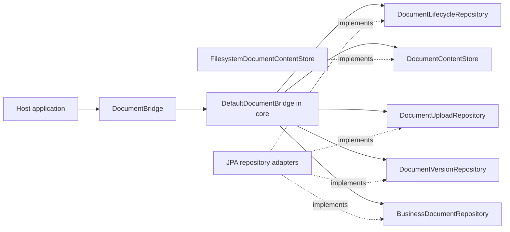

# DokuBridge

Embeddable document versioning for Java applications. See [PROJECT.md](PROJECT.md)
for scope and [AGENTS.md](AGENTS.md) for engineering rules.

## Build

Requires JDK 21 and network access to Maven Central on the first build.

```sh
./mvnw verify
```

The `core` module contains the domain snapshots, immutable JSON metadata and the
facade `DocumentBridge`, implemented by `DefaultDocumentBridge`. Its outbound
ports are `BusinessDocumentRepository`, `DocumentVersionRepository`,
`DocumentContentStore`, `DocumentUploadRepository` and `DocumentLifecycleRepository`.
The `filesystem` module provides immutable local content storage. Neither module
adds third-party runtime dependencies. The `jpa` module supplies PostgreSQL-backed
persistence adapters, Flyway migrations and short upload reservation/finalization
transactions. `autoconfigure` wires these components in Spring Boot 3, `starter`
provides host dependencies, and `sample-app` is an executable console example.

`DocumentVersion` transitions only from `PENDING` to `AVAILABLE` or `FAILED`.
Finalization returns a new snapshot; it does not persist state or store bytes.
Repeated finalization of a terminal snapshot is rejected. This local invariant
does not implement request idempotency or concurrency control in persistence.

The filesystem adapter requires a private application-controlled directory on a
filesystem with hard-link support. It publishes complete content under version
UUIDs, rejects duplicate keys and refuses to read symbolic links. See
[PROJECT.md](PROJECT.md#content-storage-contract) for failure and recovery limits.

All modules build with the command above. The PostgreSQL tests require a running
Docker daemon; Testcontainers starts and stops PostgreSQL 17.6 automatically. Tests fail
when Docker is unavailable rather than silently skipping persistence checks.
`verify` also packages the sample and runs its mandatory Failsafe integration test,
which launches the JAR twice in separate JVMs. The dependency-only starter has no
unit tests; sample verification runs after packaging rather than in `test`.
To run just the filesystem adapter and its core prerequisite:

```sh
./mvnw -pl filesystem -am verify
```

## Ports and adapters

The common namespace is `io.github.pitrecki.dokubridge`. Source packages follow
these roles, enforced by ArchUnit tests in each module:

```text
core/
  core.domain/               document model, metadata and checksums
    exception/               domain errors
  core.port.in/              DocumentBridge and document commands
  core.port.out/             repository and content-store contracts
  core.application/          DefaultDocumentBridge and request fingerprinting
filesystem/
  adapter.filesystem/        FilesystemDocumentContentStore
jpa/
  adapter.jpa/               Jpa*Repository implementations
    persistence/             JPA entities and JSONB mapping
autoconfigure/
  autoconfigure/             Spring Boot composition and configuration properties
starter/                     dependency-only JAR
sample-app/
  sample/                    console client using the inbound port
```

The flat `core` and `filesystem` public packages have been replaced by these
namespaces; consumers must update their Java imports. JPA entity names and SQL
table names remain independent of the Java package layout.



The facade exposes `attach`, `addVersion`, `updateMetadata`, `archive`, `delete`,
`get`, `findByOwner` and `getContent`.
Active and archived documents are readable; deleted documents appear absent. Content is available
only for an `AVAILABLE` version belonging to the requested document, regardless
of whether bytes already exist in storage. The host application authorizes callers
and closes content streams. See [PROJECT.md](PROJECT.md#read-facade) for errors,
metadata types and consistency limits.

The JPA module also implements `DocumentUploadRepository` for atomic request
claims, version allocation and audit finalization, plus `DocumentAuditRepository`
for committed audit history. No generic transaction runner or JPA-specific facade
is used. Its migration location is `classpath:db/dokubridge` with a dedicated
`dokubridge_flyway_history` table; migration is an explicit host setup step.

To run PostgreSQL integration checks with the other modules:

```sh
./mvnw -pl jpa -am verify
```

Uploads require a UUID request key and a declared `ContentSha256`. The core facade
verifies new streams, while PostgreSQL atomically claims requests, assigns version
numbers and records audits. Matching replays return the current version without
reading or writing bytes again. JSON object key order and numeric scale do not
create false conflicts. Both active and archived documents accept new versions.
The original three-port facade constructor remains read-only. Pass a fourth
`DocumentUploadRepository` argument to enable uploads and a fifth
`DocumentLifecycleRepository` to enable lifecycle mutations. The starter wires all
five ports.

Metadata replacement and logical lifecycle changes are atomic with their audits.
Automatic recovery and physical retention/purge remain unimplemented. See
[PROJECT.md](PROJECT.md#request-idempotency) for replay and checksum contracts and
[PostgreSQL persistence](PROJECT.md#postgresql-persistence) for transaction setup.


## Metadata and lifecycle

```java
var document = bridge.get(documentId).orElseThrow();
var updated = bridge.updateMetadata(new UpdateMetadata(
    document.id(), document.revision(), Map.of("category", "revised")));
bridge.archive(new Archive(document.id()));
bridge.delete(new Delete(document.id()));
```

Metadata is replaced completely, including on archived documents. The returned
snapshot carries the next revision. A stale `expectedRevision` conflicts; an empty
map clears metadata. Content-version allocation does not advance document revision.

Repeated archive/delete produces no additional change or audit. Deleted documents
are hidden, while binary files, versions and history remain retained. A reserved
upload can finish after deletion without making content visible. Document-only
audit events have null version/request ids; upload audits retain both identifiers.
See [PROJECT.md](PROJECT.md#document-lifecycle) for concurrency and retry semantics.
Migration V2 upgrades existing V1 data without modifying the original migration.

## Spring Boot host setup

Build and install the project locally with `./mvnw install`, then add the starter:

```xml
<dependency>
  <groupId>io.github.pitrecki.dokubridge</groupId>
  <artifactId>dokubridge-starter</artifactId>
  <version>0.1.0-SNAPSHOT</version>
</dependency>
```

Configure a PostgreSQL data source through normal Spring Boot properties and set
`dokubridge.storage.root` to a private application-controlled directory. Inject
`core.port.in.DocumentBridge` to use the library. The default repositories require
the selected entity manager factory's `JpaTransactionManager`; upload calls must
run outside host transactions.

| Property | Default | Behavior |
| --- | --- | --- |
| `dokubridge.enabled` | `true` | Enables library entity registration and default beans. |
| `dokubridge.storage.root` | unset | Required unless a `DocumentContentStore` bean is supplied. |
| `dokubridge.jpa.initialize-schema` | `false` | Runs the library Flyway migrations before JPA initialization. |

Host beans replace the corresponding default ports or facade. The entity scan
adds library entities while retaining the host's implicit scan or explicit
`@EntityScan`. Custom entity manager factories must include the library persistence
package themselves. Use a single or primary data source, entity manager factory
and transaction manager.

If the host already manages library migrations, leave schema initialization off.
Otherwise enable `dokubridge.jpa.initialize-schema=true`. The initializer waits for
Boot's host Flyway migrations, then uses its own `dokubridge_flyway_history` table.
For an existing host schema it creates a library-only baseline at version 0 before
running V1. It does not expose a competing Flyway bean or replace host history.

## Run the sample

The sample requires these environment variables for a development PostgreSQL
instance and content directory:

- `SPRING_DATASOURCE_URL`
- `SPRING_DATASOURCE_USERNAME`
- `SPRING_DATASOURCE_PASSWORD`
- `DOKUBRIDGE_STORAGE_ROOT`

After `./mvnw verify`:

```sh
java -jar sample-app/target/dokubridge-sample-app-0.1.0-SNAPSHOT.jar
```

The console application enables library schema initialization, validates the JPA
schema, attaches a document, replays the request, adds version 2 and verifies its
download through `DocumentBridge`. It then replaces metadata, archives and
logically deletes that example document, verifies read invisibility, prints its id
and exits. Each run creates another retained, logically deleted example document. It enables no HTTP endpoints and disables the
sample's separate host Flyway instance; these settings belong to the sample only.
The packaged integration test supplies an isolated PostgreSQL container and checks
two complete runs, retained data, migration history and stored files.
