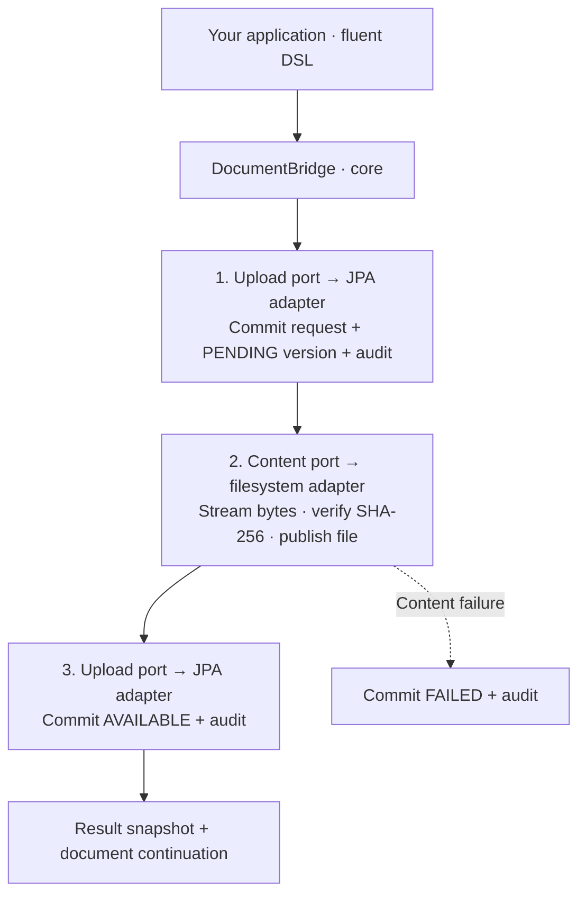

<p align="center">
  
</p>

<p align="center">Versioned document attachments for Java applications.</p>

DokuBridge attaches files, JSON metadata and audit history to your business
objects. Embed it in your application with the Spring Boot starter; PostgreSQL
stores document records and a filesystem adapter stores immutable content.
Your application owns its business model, API and authorization.

## A document, in one flow

```java
import java.io.InputStream;

var saved = bridge.upload(pdfBytes)
    .toOwner("Invoice", "42")
    .metadata("category", "invoice")
    .requestId(requestId)
    .save();

byte[] downloaded = saved.and().readContent(InputStream::readAllBytes);
var history = saved.and().versions(20);
saved.and().archive();
```

One upload creates one content version. `result()` gives its snapshot; `and()`
continues on the document. Byte arrays get a SHA-256 automatically. Keep the same
`requestId` to retry an upload without creating another version.

Prefer a callback? The same upload-and-archive flow is:

```java
bridge.upload(pdfBytes)
    .toOwner("Invoice", "42")
    .saveAndThen(document -> document.archive());
```

## Under the hood



File I/O runs between short database transactions. Interrupted finalization can
leave a version `PENDING`; explicit recovery verifies its stored content. Downloads
require `AVAILABLE`. Archive keeps a document readable; delete hides it and retains
its files and history.

## Documentation

The [GitHub Wiki](https://github.com/pitrecki/docu-bridge/wiki) covers setup, the
DSL, reads, lifecycle, recovery, architecture and storage. Its
[versioned sources](docs/wiki/Home.md) live alongside the code.

Java 21 and Docker are required to build and run the PostgreSQL integration tests:

```sh
./mvnw verify
```

See [getting started](docs/wiki/Getting-started.md) to add the starter, or
[development](docs/wiki/Development.md) to run the sample and standalone consumer.
