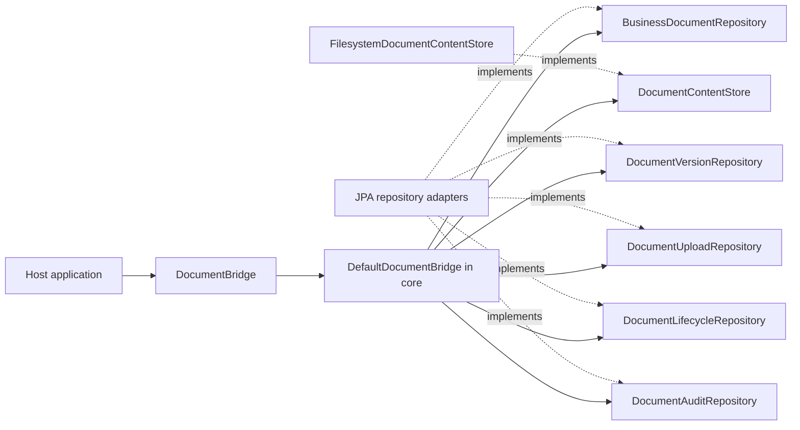

# Architecture

DokuBridge is an embeddable library for document attachments, versioned content,
JSON metadata and audit history. It is not a standalone DMS. The host owns its
business model, authorization, HTTP API and retention policy. OCR, full-text
search, workflows, ACLs, cloud storage and a reusable web module are outside the
current scope.

## Ports and adapters

The common namespace is `io.github.pitrecki.dokubridge`. Source packages follow
these roles, enforced by ArchUnit tests in each module:

```text
core/
  core.domain.document/          document, owner, metadata and lifecycle
  core.domain.version/           version snapshots and states
  core.domain.upload/            pending-upload discovery snapshots
  core.domain.content/           SHA-256 value
  core.domain.audit/             audit entries and actions
  core.domain.<feature>.exception/ document, version, content and upload errors
  core.port.in/                  DocumentBridge
    document/                    lifecycle commands, fluent contexts and results
    upload/                      upload commands and fluent drafts
  core.port.out/
    document/                    document reads and lifecycle persistence
    version/                     version lookup and history
    upload/                      reservation and finalization contracts
    audit/                       audit history contract
    content/                     binary storage contract
  core.application/              DefaultDocumentBridge
    upload/                      DocumentUploads and request fingerprinting
filesystem/
  adapter.filesystem.content/     FilesystemDocumentContentStore
jpa/
  adapter.jpa.document/           document repositories
    persistence/                 document entity, projection and JSONB mapping
  adapter.jpa.version/            version repository
    persistence/                 version entity
  adapter.jpa.upload/             upload repository
    persistence/                 request entity
  adapter.jpa.audit/              audit repository
    persistence/                 audit entity
autoconfigure/
  autoconfigure/                  Spring Boot composition
starter/                         dependency-only JAR
sample-app/
  sample/                        console client of DocumentBridge
```

The public Java packages now follow features within each architectural layer.
Update imports and rebuild consumers; this changes their binary class names.
`core.port.in.DocumentBridge` and `core.application.DefaultDocumentBridge` retain
their paths. Domain exceptions live with the feature that owns them.

| Previous import suffix | Current import suffix |
| --- | --- |
| `core.domain.BusinessDocument` | `core.domain.document.BusinessDocument` |
| `core.domain.ContentSha256` | `core.domain.content.ContentSha256` |
| `core.domain.DocumentVersion` | `core.domain.version.DocumentVersion` |
| `core.port.in.AttachDocument` | `core.port.in.upload.AttachDocument` |
| `core.port.in.UpdateMetadata` | `core.port.in.document.UpdateMetadata` |
| `core.port.out.DocumentVersionRepository` | `core.port.out.version.DocumentVersionRepository` |
| `adapter.jpa.JpaDocumentUploadRepository` | `adapter.jpa.upload.JpaDocumentUploadRepository` |
| `adapter.jpa.persistence.*` | `adapter.jpa.<feature>.persistence.*` |
| `adapter.filesystem.FilesystemDocumentContentStore` | `adapter.filesystem.content.FilesystemDocumentContentStore` |

Custom entity manager factories must update explicit library scans to the four
feature persistence packages, or scan `io.github.pitrecki.dokubridge.adapter.jpa`.
Boot auto-configuration registers the four packages automatically. JPA entity
names, SQL tables, Flyway migrations and persisted request fingerprints are
unchanged by the package split.



The facade exposes `attach`, `addVersion`, `updateMetadata`, `archive`, `delete`,
`get`, `findByOwner`, `getVersions`, `getAudit`, `getContent`, `pendingUploads`
and `reconcileUpload`.
Active and archived documents are readable; deleted documents appear absent. Content is available
only for an `AVAILABLE` version belonging to the requested document, regardless
of whether bytes already exist in storage. The host application authorizes callers
and closes raw content streams. See [reading documents](Reading-documents.md) for errors,
visibility and consistency limits.

The JPA module also implements `DocumentUploadRepository` for atomic request
claims, version allocation and audit finalization, plus `DocumentAuditRepository`
for committed audit history. No generic transaction runner or JPA-specific facade
is used. Its migration location is `classpath:db/dokubridge` with a dedicated
`dokubridge_flyway_history` table; migration is an explicit host setup step.

To run PostgreSQL integration checks with the other modules:

```sh
./mvnw -pl jpa -am verify
```

Uploads require a UUID request key and a declared `ContentSha256`. The core facade
verifies new streams, while PostgreSQL atomically claims requests, assigns version
numbers and records audits. Matching replays return the current version without
reading or writing bytes again. JSON object key order and numeric scale do not
create false conflicts. Both active and archived documents accept new versions.
The original three-port facade constructor remains read-only. The existing
upload constructor accepts `DocumentUploadRepository` as its fourth argument;
its five-port variant also enables lifecycle mutations. Audit composition is
shown below. The starter wires all six ports.

Metadata replacement and logical lifecycle changes are atomic with their audits.
Automatic recovery and physical retention/purge remain unimplemented. See
[uploads and recovery](Uploads-and-recovery.md) for replay and checksum contracts and
[persistence and storage](Persistence-and-storage.md) for transaction setup.

## Module responsibilities

| Module | Responsibility |
| --- | --- |
| `core` | Domain model, commands, `DocumentBridge`, `DefaultDocumentBridge`, storage and repository ports |
| Filesystem adapter | Local binary storage via `DocumentContentStore` |
| JPA adapter | Persistence and audit adapters backed by JPA |
| Auto-configuration | Spring wiring and configuration defaults |
| Starter | Dependencies needed by host applications |
| `sample-app` | Usage example and optional demonstration REST endpoints |

`DefaultDocumentBridge` remains technology-neutral. JPA implements repository ports; it is not a second document facade. Avoid a generic transaction runner or database-specific assumptions in the core.


The core uses Guava `Closer` privately for managed stream cleanup. Guava types
stay out of domain types, outbound ports and public signatures. ArchUnit checks
enforce dependency direction and feature packages.

## Composition

```java
var readOnly = new DefaultDocumentBridge(documents, versions, content);
var readWithAudit = new DefaultDocumentBridge(documents, versions, audits, content);
var full = new DefaultDocumentBridge(documents, versions, content, uploads, lifecycle, audits);
```

The four-port upload constructor enables uploads without lifecycle changes; the
five-port form additionally enables lifecycle mutations. Unsupported optional
operations fail explicitly. Spring Boot's starter composes the full implementation
and respects host overrides. See [getting started](Getting-started.md).
